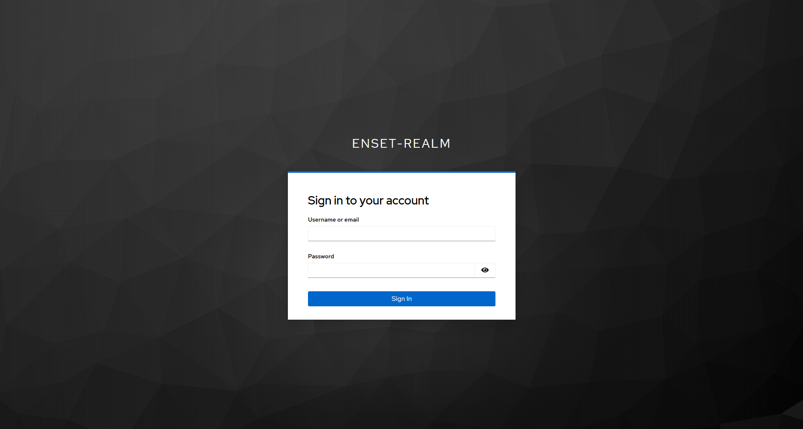
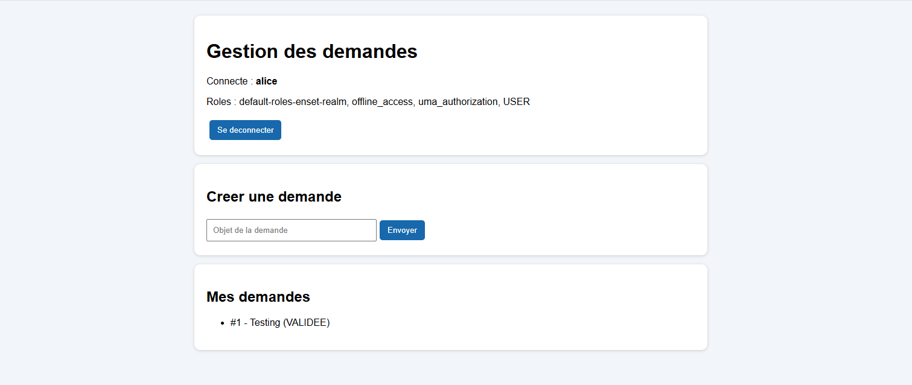
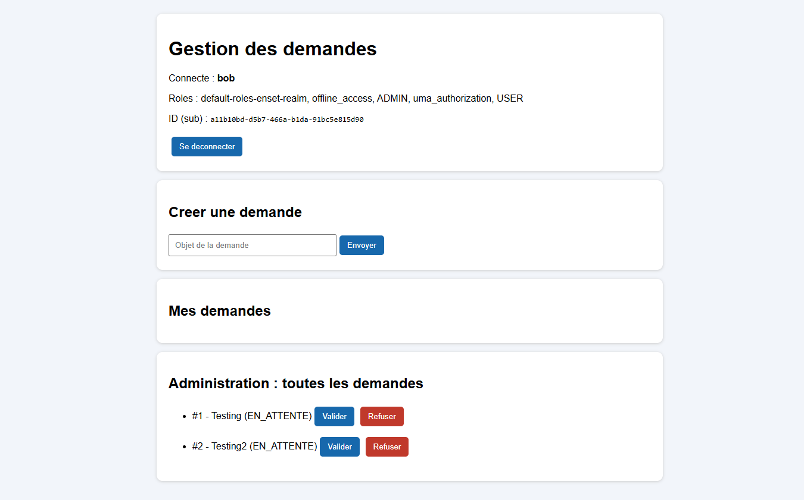
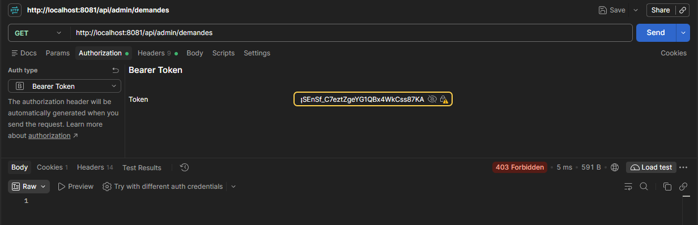
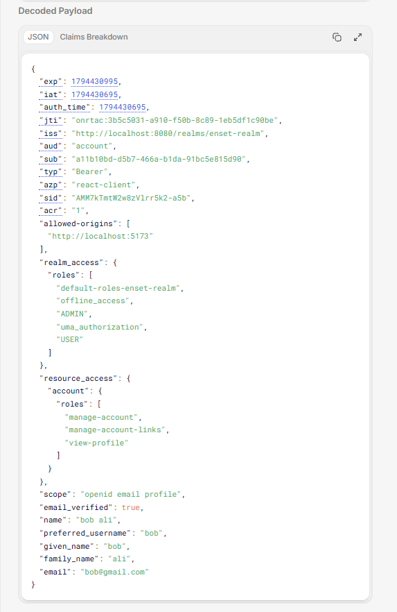

# Atelier OAuth 2.0 / OpenID Connect avec Keycloak

Sécurisation d'une application **React + Spring Boot** avec **Keycloak**, en utilisant le flux *Authorization Code* avec **PKCE** et des **Access Tokens JWT**.

## Architecture

| Composant | Technologie | Port |
|---|---|---|
| Serveur d'identité | Keycloak 26 (Docker) | 8080 |
| API sécurisée | Spring Boot 4.1.2 / Spring Security | 8081 |
| Frontend | React + Vite + `keycloak-js` | 5173 |

1. React redirige l'utilisateur vers Keycloak pour se connecter.
2. Keycloak renvoie un code d'autorisation, échangé contre des jetons (PKCE).
3. React appelle l'API avec `Authorization: Bearer <token>`.
4. Spring Security vérifie la signature du JWT et les rôles `USER` / `ADMIN`.

## Structure du projet

```
.
├── docker-compose.yml     # Keycloak
├── demandes-api/          # API Spring Boot (Resource Server)
├── demandes-front/        # Frontend React (client OIDC)
└──  screenshots/      # Captures d'écran
```

## Lancer le projet

**1. Keycloak**

```bash
docker compose up -d
```

Console : http://localhost:8080 (admin / admin). Créer le realm `enset-realm`, le client public `react-client` (Standard flow, PKCE S256), les rôles `USER` et `ADMIN`, et les utilisateurs :

| Utilisateur | Mot de passe | Rôles |
|---|---|---|
| alice | alice123 | USER |
| bob | bob123 | USER, ADMIN |

**2. API Spring Boot**

```bash
cd demandes-api
./mvnw spring-boot:run      # Windows : .\mvnw.cmd spring-boot:run
```

**3. Frontend React**

```bash
cd demandes-front
npm install
npm run dev
```

Ouvrir http://localhost:5173 : la page de connexion Keycloak s'affiche.

## Endpoints

| Méthode et route | Accès |
|---|---|
| `GET /api/public` | Public |
| `GET /api/demandes` | USER, ADMIN |
| `POST /api/demandes` | USER, ADMIN |
| `GET /api/admin/demandes` | ADMIN |
| `PATCH /api/admin/demandes/{id}` | ADMIN |
| `GET /api/profil` | Authentifié |

## Captures d'écran

**Connexion via Keycloak**



**Alice (USER) : pas de panneau d'administration**



**Bob (ADMIN) : valider ou refuser une demande**



**Alice sur l'API d'administration : 403 Forbidden**



**Contenu décodé de l'Access Token**



## Tests de sécurité

| Test | Résultat |
|---|---|
| Requête sans jeton | `401 Unauthorized` |
| Jeton modifié | `401 Unauthorized` |
| Alice (USER) sur `/api/admin/**` | `403 Forbidden` |
| Bob (ADMIN) sur `/api/admin/**` | `200 OK` |

> Masquer le panneau Admin dans React ne suffit pas : c'est Spring Security qui protège réellement l'API.

## Travail supplémentaire

- Bouton **Refuser** pour les administrateurs (statut `REFUSEE`)
- Endpoint **`GET /api/profil`** renvoyant l'identifiant et le nom d'utilisateur extraits du JWT

---
